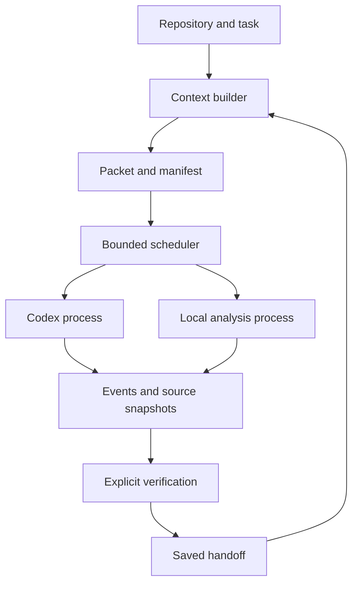

# Architecture and data flow

The program separates repository evidence, selected context, execution, and verification. Scanning and default planning are deterministic; model calls happen only when the user starts a run or explicitly benchmarks a local model.

## Modules

| Module | Responsibility |
|---|---|
| agent_config.py / agent_commands.py | Portable project definitions, schema validation, frozen configuration, managed-run CLI, messages and event inspection. |
| agent_runtime.py | Bounded worker/check/reviewer controller, structured decisions, scoped file tools, project commands, delegation and local mailboxes. |
| swarm.py | Parallel candidate runtimes in separate worktrees, shared swarm budget, critic ranking, feedback rounds, convergence and freshness-checked integration. |
| worktree.py | Git baseline from the working tree via a temporary index, detached worktrees, candidate commits/diffs, resets, review branches and patch application; hooks disabled. |
| claude_bridge.py / feedback_worker.py | Optional SDK sessions, in-process MCP tools, hook events, structured results and isolated worker lifecycle. |
| dashboard.py and web/ | Loopback GUI, session-token HTTP API, queued tasks, dependency handoffs, cancellation and packaged interface assets. |
| adapters.py | OpenCode command adapter, display event normalization, public connection hints and Linux process socket sampling. |
| `common.py` | Configuration validation, atomic writes, advisory locks, timestamps, hashes, SQLite records. |
| `project.py` | File filtering, inventory, manifest-derived commands, helper recommendations, ranking, instruction discovery estimates, source snapshots. |
| `context.py` | Bounded excerpts, nested guidance, budget estimates, packets and inclusion manifests. |
| `runner.py` | Scripted subprocess lifecycle, event parsing, time/output limits, source audits, checkpoints, and explicit verification. |
| `local.py` | Loopback-only Ollama API, hardware diagnostics, foreground serving, model aliases and benchmark. |
| `local_worker.py` | Isolated HTTP client process so the parent can cancel or time-bound a local request. |
| `team.py` | Explainable planning heuristic, graph validation, dependency scheduling and exclusive writes. |
| `cli.py` | Commands, interactive Codex launch, continuation flow, and human-readable output. |

## Source and state

The repository is authoritative. Markdown handoffs describe progress, SQLite records executions, and hashes detect changes to scanned text. A model's summary is always labeled as reported rather than independently established. Raw provider events and verification logs remain available for inspection.

The scanner's exclusions mean a snapshot is not a fingerprint of every byte in the directory. Large assets, ignored data, environment changes, installed dependencies, and external services can change without invalidating the text fingerprint. Verification messages therefore describe the current *scanned source*, not complete reproducibility.

The instruction estimate covers standard user/root discovery and recognized fallback names from inspected config. It does not attempt to duplicate Codex's full configuration resolver, profile layering, trust decisions, or managed instruction system. Nested instructions relevant to included files are supplied explicitly. Existing instruction files are not rewritten.

## Execution semantics

Scripted Codex is invoked with an argument array and a packet file as stdin; no task text is interpolated into a shell command. Its stdout and stderr are drained concurrently, with a wall-clock deadline and 16 MiB combined output limit. Process groups receive termination on interruption or deadline.

The provider's `turn.completed` event, successful exit, and absence of reported failure determine `completed`. A zero exit alone is insufficient. Unknown event shapes remain in raw logs. Usage is stored only when reported; missing counts are not treated as zero cost.

Interactive Codex is attached to the terminal. Its exit only establishes that the UI closed; the stored status is `interactive_closed`. Its usage and final answer are not available to this wrapper.

Direct local analysis runs the HTTP client in a child process with no execution tools supplied to the model. Terminating that client bounds the wrapper; a server can take additional time to release a disconnected request. The model server is a separate process shared across sessions, rather than a separate model allocation per agent.

## Scheduling

The default planner chooses either one writer or up to two focused readers followed by one writer. Its task matching is heuristic and intended to be reviewed. An explicit JSON graph is the contract for a team run.

Readers can run together. A writer waits until all active workers finish, then runs exclusively. Local requests are limited to one inside the scheduler and protected by a per-user advisory lock across agentctl projects. Calls from unrelated programs are outside that lock; set Ollama's own concurrency to one as well.

Nested Codex multi-agent tools are disabled for these managed runs. There is no recursion, automatic retry loop, auto-merge, or automatic deployment to a remote host. The operation lock prevents two cooperating agentctl commands from changing the same project simultaneously. It is not a security sandbox.

Write scopes are post-run audits. Violations are reported and preserved for review, because automatic rollback could destroy unrelated changes. The Codex sandbox remains the tool-execution boundary. v0.1 deliberately serializes writers instead of implementing worktree merging.

## Continuation

`checkpoint` writes the observed source state, run status, explicit check evidence, user notes, and next action. `resume` re-scans current files and constructs a fresh packet. It maintains a stable original objective rather than nesting the full sequence of prior task prompts. It carries a bounded handoff and surfaces detected file changes.

For long-lived work, store durable design choices in the project's normal documentation. The handoff should contain only active state and links to that documentation. Refresh a checkpoint at task boundaries, not after every message.

## Extension order

1. Add a model-specific tokenizer if measurements show the estimator matters; keep unknown runtime overhead explicit.
2. Add syntax-aware retrieval when filename and lexical ranking misses important dependencies.
3. Add measured routing based on representative successful tasks, latency, and total reported tokens.
4. Isolated worktrees and an integration stage now exist for swarm candidates (see below). Extending them to `team` graphs and the dashboard scheduler, and combining non-conflicting changes from several candidates, remain open.
5. Add a structured planning model as an opt-in capability; retain deterministic graph validation.
6. Add remote deployment only with explicit host configuration and an accountable process lifecycle.

The first release uses SQLite and files so its behavior can be inspected without running another database or web service.

## Swarm workflows and worktree integration

A swarm's feedback_worker process runs SwarmRuntime instead of the single worker/reviewer loop. SwarmRuntime creates one AgentRuntime per candidate slot, rooted at that slot's worktree. All file tools, scope audits, snapshots, project commands and CLI peers therefore operate on the candidate's files. Each child runtime defers cancellation, wall-clock and cost limits to the swarm. Call, tool and depth limits stay per candidate.

Candidate events are relayed with an actor of the form slot.agent. Checks inside a worktree are therefore never recorded as verification evidence for the user's checkout. Only the integration step emits controller check events against the real project root.

The run still holds the project's exclusive operation lock, so no other managed writer changes the checkout while a swarm runs. Integration has three guards:

- It compares the current scanned-source fingerprint with the fingerprint taken at the baseline.
- It runs `git apply --check` before applying.
- It changes the working tree only, never the index or refs.

CLI-launched Codex and OpenCode peers of a candidate keep their run records inside that candidate's worktree state directory. They are linked from peer.link events.

## Version 0.3 dashboard

Version 0.4 adds an explicit feedback controller above the individual agent runtimes. Each iteration runs the configured worker, command checks and a read-only reviewer. The controller validates the decision and check freshness before accepting; revision feedback is addressed back to the worker for a new bounded iteration. This behavior is separate from the legacy fixed workflow graphs.

SDK sessions expose only assigned custom tools and explicit MCP servers. Named peer calls select a configured backend; Codex/OpenCode/local peers reuse the existing runner. Native Codex peers receive an output schema. File and command actions remain serialized inside the managed workflow, which owns the project's exclusive operation lock.

The GUI monitors managed runs launched either by the dashboard or by the CLI. It preserves ownership: terminal-launched processes remain controlled in their terminal, while project-local mailbox feedback can be queued from either surface. Required command checks are also recorded as normal verification evidence, including output-contract failure and scanned-source freshness.

The GUI controller calls the existing prepare_run/execute_run functions. It prepares context at dispatch time, retains their freshness guards and preserves completion/verification semantics. Optional runner callbacks expose process IDs and live metadata; raw stdout and stderr are still drained together with deadlines and output bounds.

The dashboard owns one project controller lock and takes the existing operation lock while its managed jobs are active. It schedules readers together and writers exclusively, including OpenCode jobs whose CLI-managed permissions are not represented as OS sandboxing. Built-in workflow role contracts compile through the existing validator; GUI dependencies pass bounded reported results with artifact paths.

The frontend uses local HTML/CSS/JavaScript and polls a token-protected HTTP API. It renders provider content as text nodes. No network-loaded interface libraries, frontend build tools or third-party Python dependencies are required.

The OpenCode adapter uses its installed CLI's JSON interface and file attachments. A private standalone server is requested when supported. OpenCode authentication, provider routing and tool permission enforcement remain OpenCode responsibilities. Native subagents are discouraged in the task contract; only top-level managed jobs are controlled by this scheduler.

Connection hints expose allowlisted configuration fields. Live TCP samples use Linux process descriptors and network tables; neither is treated as proof of provider authentication or billing. No reverse DNS queries or external connection probes are made.
